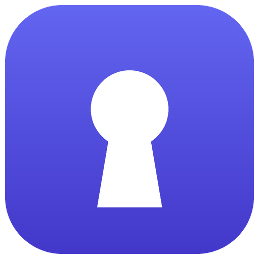

<p align="center"></p>

<h1 align="center">Multiwarden</h1>

<p align="center">
  All your vaults, working as one.
</p>

<p align="center">
  <a href="https://github.com/multiwarden/clients/releases/latest"></a>
  <a href="https://github.com/multiwarden/clients/actions/workflows/multiwarden-ci.yml"></a>
  
  
</p>

<p align="center">
  <a href="https://multiwarden.com">Website</a> ·
  <a href="https://chromewebstore.google.com/detail/multiwarden-multi-account/cdigmfigoadangkckfadcmhabplleakc">Chrome Web Store</a> ·
  <a href="https://github.com/multiwarden/clients/releases">Releases</a> ·
  <a href="../multiwarden/README.md">Maintainer notes</a>
</p>

---

## Overview

The official Bitwarden extension lets you sign in to several accounts, but only the _active_
account takes part in autofill, saving and passkeys. Running two copies side by side makes them
compete for the same fields.

Multiwarden is an unofficial fork of the Bitwarden browser extension and desktop app in which
every unlocked account takes part. It stays close to
upstream: new behaviour lives in separate files, and upstream code only receives small, marked
hooks.

> [!NOTE]
> Multiwarden is experimental. It is used daily, but it is not audited and not supported by
> Bitwarden. Keep the official extension disabled while Multiwarden is installed.

## What changes

| Area                  | Upstream Bitwarden          | Multiwarden                                                                                                    |
| --------------------- | --------------------------- | -------------------------------------------------------------------------------------------------------------- |
| **Inline autofill**   | Active account only         | Suggestions from all unlocked accounts, each labelled with its account                                         |
| **Save prompt**       | Saves to the active account | Account selector, pre-set to the account last used on that site; existing logins are recognised in any account |
| **Password updates**  | Active account              | Written to the account that owns the login                                                                     |
| **Passkeys**          | Active account              | Found in every unlocked account; new passkeys ask where to save                                                |
| **Keyboard shortcut** | Active account              | Falls back to other unlocked accounts                                                                          |
| **Vault view**        | One account at a time       | Optional **Combined** view: all vaults in one list, each item marked with its account                          |
| **New items**         | Active account              | In combined view, asks which vault to save to                                                                  |
| **Settings**          | —                           | **Settings → Multiwarden**: per-site save account, hide Premium notices, version details                       |

Also included: Multiwarden branding and icons, translations for every extension language,
builds for Chromium browsers, Firefox and Safari, and an automated nightly sync with upstream.

The **desktop app** has the Combined view (vault list, account badges, "save to which vault?"),
the Multiwarden settings tab, and installs next to Bitwarden's desktop app.

## Browser support

| Browser                | Package                             | Notes                                                                     |
| ---------------------- | ----------------------------------- | ------------------------------------------------------------------------- |
| Chrome, Vivaldi, Brave | `multiwarden-chrome-*.zip`          | Manifest V3                                                               |
| Edge                   | `multiwarden-edge-*.zip`            | Manifest V3                                                               |
| Opera                  | `multiwarden-opera-*.zip`           | Manifest V3                                                               |
| Firefox                | `multiwarden-firefox-*.zip`         | Manifest V2; temporary add-on until signed by Mozilla                     |
| Safari (macOS)         | `multiwarden-safari-unsigned-*.zip` | Unsigned test build; see the [maintainer notes](../multiwarden/README.md) |

## Desktop app

| System  | Package                                                    | Notes                                                      |
| ------- | ---------------------------------------------------------- | ---------------------------------------------------------- |
| Windows | `Multiwarden-*-Setup.exe`, `Multiwarden-*-Portable.exe`    | Unsigned: SmartScreen asks for confirmation on first start |
| macOS   | `Multiwarden-*-mac-universal.dmg`                          | Not notarized: right-click → **Open** the first time       |
| Linux   | `Multiwarden-*-x86_64.AppImage`, `Multiwarden-*-amd64.deb` |                                                            |

It is a separate app with its own data, so Bitwarden's desktop app can stay installed. It does
not update itself; new versions are on the releases page.

Its version number follows Bitwarden's desktop app (for example `2026.11.1.4` in a release
tagged `v2026.11.0.4`), because Bitwarden's servers turn some features on by app version. The last
number is the same Multiwarden release number as the extension's.

## Install

**Chrome, Brave, Vivaldi and other Chromium browsers**: install Multiwarden from the
[Chrome Web Store](https://chromewebstore.google.com/detail/multiwarden-multi-account/cdigmfigoadangkckfadcmhabplleakc). It updates itself from there.

For the other browsers, download the package for your browser from the
[latest release](https://github.com/multiwarden/clients/releases/latest) and unzip it. Disable the
official Bitwarden extension first.

**Chromium browsers (without the store)**

1. Open the extensions page (`chrome://extensions`, `edge://extensions`, `opera://extensions`, …).
2. Turn on **Developer mode**, choose **Load unpacked** and select the unzipped folder.

**Firefox**

1. Open `about:debugging#/runtime/this-firefox`.
2. Choose **Load Temporary Add-on** and select `manifest.json` in the unzipped folder. Firefox
   removes unsigned add-ons when it restarts.

Then sign in to each account through the account switcher (up to five) and unlock them.

## How it is built

```
bitwarden/clients  ──nightly sync──▶  multiwarden  ──CI──▶  tested, branded zips  ──tag──▶  release
                                         │
                                         ├─ multiwarden-only files   (all new logic)
                                         └─ "Multiwarden:" hooks     (small, marked edits upstream)
```

- **Hooks, not rewrites.** `git grep -n "Multiwarden:"` lists every place upstream code is touched.
- **Upstream sync.** A nightly workflow applies upstream changes with a 3-way merge and opens a PR.
- **Branding after build.** Names, icons and strings are applied to the finished build, so they
  never conflict with upstream.
- **Open-source only.** Builds use the GPL code alone; nothing under `bitwarden_license/` is
  included.

Build steps, the file map and the sync process are in the
[maintainer notes](../multiwarden/README.md).

## Repositories

| Repository                                                            | Contents                                                |
| --------------------------------------------------------------------- | ------------------------------------------------------- |
| [multiwarden/clients](https://github.com/multiwarden/clients)         | The browser extension and desktop app (this repository) |
| [multiwarden/android](https://github.com/multiwarden/android)         | The Android app                                         |
| [multiwarden/multiwarden](https://github.com/multiwarden/multiwarden) | The website, logos and store screenshots                |

## Contributing and security

Bug reports and pull requests are welcome; see [CONTRIBUTING.md](CONTRIBUTING.md). Please report
security problems privately, as described in the [security policy](SECURITY.md).

## License and trademarks

Multiwarden is licensed under the GNU GPL v3, like the upstream code it is based on. See
[NOTICE](../NOTICE) for attribution and for the Bitwarden-licensed code that Multiwarden does not
use.

Multiwarden is **not affiliated with, endorsed by, or supported by Bitwarden, Inc.** "Bitwarden"
is a registered trademark of Bitwarden Inc., used here only to describe compatibility. Please
report Multiwarden issues [here](https://github.com/multiwarden/clients/issues), not to Bitwarden.
